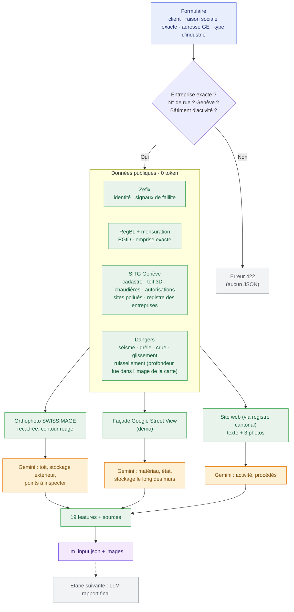

# AXA Smart Property — Genève

Hackathon AXA B2B · LauzHack 2026 · *Frugal use of Multimodal AI*

**But :** à partir d'un formulaire de 4 champs, produire automatiquement le dossier de pré-souscription d'une **PME genevoise qui occupe son propre bâtiment d'activité** (atelier, usine, entrepôt, menuiserie…) : 19 features de risque, chacune sourcée, avec les images du bâtiment.

**Principe :** *API first, LLM last.* Tout ce qui est disponible dans les registres et géodonnées officiels (Zefix, RegBL, mensuration, SITG Genève, OFEV, MétéoSuisse) est lu en Python → 0 token. Le modèle vision (Gemini via OpenRouter) n'intervient que sur les **images** (orthophoto du bâtiment, photos du site web) ≈ CHF 0.001 par bâtiment.

---

## Démarrage

```bash
python -m venv .venv && .venv/Scripts/pip install -r requirements.txt uvicorn
cp .env.example .env        # mettre LLM_API_KEY (OpenRouter) dans .env — jamais dans .env.example

# Partie 1 : tout jusqu'au JSON donné au LLM final
python scripts/build_llm_input.py "Marie Dupont" "CMDS SA" "Rue du Champ-Blanchod 7, 1228 Plan-les-Ouates" --industry metalworking
python -m src.validate probe_out/cmds-sa/llm_input.json            # → OK

uvicorn src.main:app --reload    # POST /api/llm-input[?for_llm=true] · GET /api/industries · GET /api/health
```

`build_llm_input.py` écrit dans `probe_out/<entreprise>/` : `llm_input.json` (photos incluses en base64), `llm_input.for_llm.json` (sans les photos) + les photos en `.jpg`. Option `--no-vision` = 0 token.

---

## Entrées (formulaire)

| Champ | Contrôle |
|---|---|
| `client_name` | — |
| `company_legal_name` | **Nom exact** au registre du commerce (AG = SA = Ltd, GmbH = Sàrl acceptés). Introuvable → erreur 422 |
| `address` | Adresse du bâtiment `Rue N, NPA Localité`. N° introuvable → 422 (jamais de rapport sur le voisin) |
| `industry_type` | Liste déroulante (`GET /api/industries`) : menuiserie, métallurgie, traitement de surface, boulangerie, viande/laiterie, imprimerie, garage, plastiques/chimie, entrepôt, précision, textile, autre |

**Hors périmètre → 422** : bâtiment hors canton de Genève ; logement ou immeuble mixte (selon le cadastre SITG, qui fait foi à Genève — le RegBL classe parfois un atelier en « maison individuelle »).
**Service public indisponible → 503** (réessayer).

---

## Pipeline



---

## Les 19 features

Format de chaque feature : `{"feature", "value", "status", "requires_verification"}` — sources et notes dans `feature_evidence`.

| Feature | Prio | Source principale (Genève) | Couverture* |
|---|---|---|---|
| `building_usage` | P0 | Cadastre SITG (destination) | 12/12 |
| `construction_year` | P0 | RegBL / cadastre SITG | 12/12 |
| `floor_area_m2` | P0 | Indice énergétique SITG (surface chauffée), sinon emprise × niveaux | 12/12 |
| `number_of_floors` | P0 | RegBL / cadastre SITG | 12/12 |
| `business_sector` | P0 | Registre cantonal des entreprises (NOGA) + type déclaré | 12/12 |
| `earthquake_exposure` | P0 | Zone SIA 261 + classe de sol (OFEV) | 12/12 |
| `flood_exposure` | P0 | Cartes de dangers cantonales | 12/12 |
| `surface_runoff_exposure` | P0 | Carte OFEV — part du pourtour + **profondeur lue dans les couleurs** | 12/12 |
| `hail_exposure` | P0 | MétéoSuisse (grêle 50 ans) | 12/12 |
| `landslide_exposure` | P0 | Cartes de dangers cantonales | 11/12 |
| `roof_type_material` | P1 | Forme : cadastre 3D (pente) · matériau : vision | 12/12 |
| `building_renovations` | P1 | Autorisations de construire + année de transformation (sinon « aucune rénovation enregistrée ») | 12/12 |
| `site_industrial_processes` | P1 | Autorisations, site web, sites pollués, type d'industrie | 12/12 |
| `high_temperature_operations` | P1 | Autorisations (four, cuisson…), site web, type d'industrie | 10/12 |
| `gas_installations` | P1 | **Registre des chaudières** + autorisations (« gaz ») + type d'industrie | 9/12 |
| `flammable_material_storage` | P1 | Chaudière/citerne mazout, autorisations (citerne, stockage), sites pollués | 12/12 |
| `potential_repair_needs` | P1 | Vision (à inspecter, jamais confirmé) | 6/12 |
| `construction_material` | P1 | **Façade Google Street View** + vision (garde-fous : photos Google uniquement, façade visible, enseigne ou cohérence des étages) | 8/12 |
| `reconstruction_value_chf` | P2 | Volume (cadastre) × CHF/m³ selon type — **approximatif** | 12/12 |

\* sur 12 PME industrielles genevoises réelles (ateliers mécaniques, traitement des métaux, alimentaire, garage, logistique). **P0 99 % · P1 88 %**.

`status` : `verified` (registre officiel) · `observed` (vision) · `inferred` (site web / secteur / industrie déclarée) · `declared` (client) · `estimated` (calcul) · `unknown` (non trouvé, `value = null`).

**Retirées** (introuvables dans les données publiques — 20 autorisations mentionnent des sprinklers sur tout le canton) : sprinklers, détection incendie, compartimentage, protection crue, sinistres antérieurs, état des conduites → à demander au client hors pipeline.

**Contrainte légale** : l'exposition aux dangers naturels (crue, ruissellement, grêle, glissement) sert à la souscription et à la prévention, **pas de surcharge de prime individuelle** pour la couverture réglementée.

**Valeur de reconstruction** = ce que l'assureur paie pour reconstruire après un dommage (valeur à neuf, base de la somme d'assurance). Genève : marché privé, valeur à neuf = volume × prix au m³, indexée sur l'indice genevois de la construction (161.8 en 2025, base 1988). Prix au m³ indicatifs (`src/reconstruction.py`), à remplacer par la grille AXA.

---

## Sortie — `llm_input.json`

Schéma : `schemas/llm_input.schema.json` · validation : `python -m src.validate <fichier>`.

| Bloc | Contenu |
|---|---|
| `request` | les 4 entrées |
| `identification` | UID, statut au registre, signaux de faillite, EGID, canton, NOGA, taille, `annual_revenue_chf` / `estimated_market_value_chf` / `requested_coverages` / `insurance_premium_estimate_chf` (null = non public / non calculé) |
| `features` | les 19 features |
| `feature_evidence` | par feature : `source_ids` + note |
| `feature_coverage_before_llm` | remplissage P0 / P1 / P2 |
| `sources` | liste centrale (`src_*`) |
| `evidence` | données brutes : registres + SITG, sortie de Gemini sur l'orthophoto, extraction du site web |
| `images` | photos **incluses en base64** : `images[nom] = {label, credit, shows, mime, data_url}` (`orthophoto.jpg`, `facade_streetview.jpg`, `website_N.jpg`) |
| `metrics` | appels LLM, tokens, coût, durée |

### Pour l'étape LLM (rapport final)

- **Exemples prêts à l'emploi** (vraie sortie, CMDS SA) : `examples/llm_input.example.json` (complet ; base64 des photos remplacé par un marqueur) et `examples/llm_input.for_llm.example.json` (ce que le LLM reçoit).
- **Ne jamais envoyer les photos au LLM** (une photo en base64 = des centaines de milliers de tokens). Envoyer `for_llm_text(doc)` — même JSON sans les `data_url`, ≈ 4 300 tokens — ou appeler `POST /api/llm-input?for_llm=true`.
- Le LLM voit le catalogue `images[nom] = {label, shows, credit}` et **cite les photos par leur nom** dans le rapport (ex. `"facade_streetview.jpg"`) ; le rendu insère `doc["images"][nom]["data_url"]` (``).
- Rappels pour le prompt : `unknown` = non trouvé (jamais deviné) ; dangers naturels = information de souscription/prévention, pas de surcharge de prime ; Street View = démo.

```python
from src.pipeline import run, for_llm_text
doc = run("Marie Dupont", "CMDS SA", "Rue du Champ-Blanchod 7, 1228 Plan-les-Ouates", "metalworking")
prompt_json = for_llm_text(doc)          # → LLM
photos = doc["images"]                   # → rendu du rapport
```

---

## Code

```
src/pipeline.py          run() → llm_input.json · for_llm_text() · save() · contrôles de périmètre
src/public_data.py       Zefix, géocodage, RegBL, emprise (mensuration → SITG), dangers, orthophoto
src/geneva.py            SITG : cadastre, toit 3D, énergie, chaudières, autorisations, sites pollués, établissements
src/company_profile.py   statut registre + signaux de faillite (API zefix.ch)
src/building_condition.py âge / état / chauffage (RegBL)
src/reconstruction.py    valeur de reconstruction (volume × CHF/m³)
src/industries.py        types d'industrie (formulaire) → procédés typiques
src/web_scrape.py        site web : texte, phrases à risque, photos
src/streetview.py        façade Google Street View (démo)
src/blocks.py            blocs de preuves + appels vision (orthophoto, façade, site web)
src/features.py          les 19 features + sources
src/prompts.py           prompts + sous-schémas JSON stricts des appels vision
src/llm.py               seul point d'entrée LLM : json_schema, retry, cache, tokens, coût
src/validate.py          validation de llm_input.json
src/main.py              API FastAPI (Vercel)
scripts/build_llm_input.py   un llm_input.json
scripts/llm_input_matrix.py  un lot d'entreprises → tableau de couverture des features
scripts/probe_sources.py     debug : toutes les sources publiques sur une adresse
examples/                    llm_input exemple (complet + version LLM)
schemas/llm_input.schema.json  contrat de sortie
```

## Hébergement

- **Modèles** : OpenRouter (clé AXA). Vision + extraction : `google/gemini-2.5-flash-lite` (≈ CHF 0.0005 par bâtiment).
- **Vercel** : FastAPI = une fonction Python ; pas d'écriture disque hors `/tmp` ; cache LLM via Upstash Redis si configuré ; 13–60 s par bâtiment (< 300 s).

## Limites connues

- Vision non évaluée : sur un cas, elle a attribué au bâtiment des lanterneaux du voisin. Évaluation possible contre les registres SITG (toit, panneaux solaires, toits verts).
- Grands bâtiments partagés (plusieurs entreprises) : la valeur de reconstruction porte sur tout le bâtiment.
- Hauteur du cadastre parfois aberrante (cheminées) → contrôlée ; surface chauffée couvrant plusieurs bâtiments → contrôlée.
- Signaux de faillite via l'API de zefix.ch (non officielle) → en production : identifiants ZefixPublicREST.
- **Street View = démo hackathon** : les conditions Google sont restrictives sur l'extraction de données par IA. 1 image par rapport, non stockée, attribution affichée. En production : imagerie sous licence ou photo fournie par le client. Mapillary testé : quasi aucune couverture en zone industrielle.
- Street View peut viser un bâtiment voisin (rejeté si l'écart d'étages avec le cadastre est ≥ 3 sans enseigne visible).

## Sources

[Zefix](https://www.zefix.ch) · [RegBL](https://www.housing-stat.ch) · [SITG](https://sitg.ge.ch) · [geodienste.ch](https://geodienste.ch) · [geo.admin.ch](https://www.geo.admin.ch) · [SWISSIMAGE](https://www.swisstopo.admin.ch/fr/orthophotos-swissimage-10-cm) · [OpenRouter](https://openrouter.ai)
