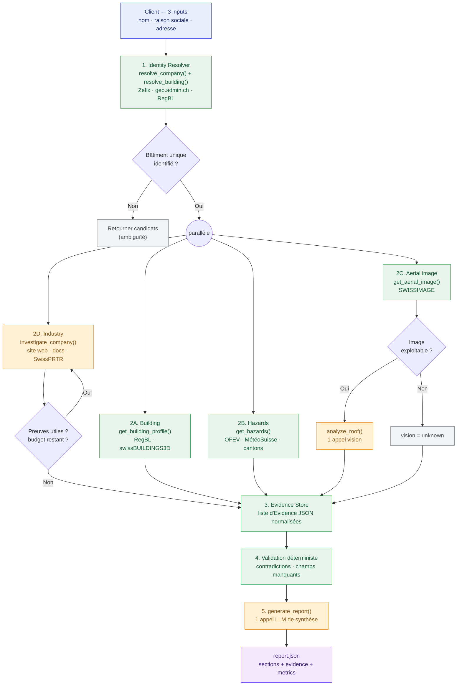

# AXA Smart Property — Plan de réalisation

Hackathon AXA B2B · LauzHack 2026

**But :** à partir de **3 champs client** (nom, raison sociale, adresse), produire automatiquement un **dossier de pré-souscription** pour un bâtiment : identité, caractéristiques, dangers naturels, exposition incendie/industrielle, inconnues à vérifier. Chaque valeur est sourcée.

**Principe :** *API first, LLM last.* Tout ce qui se fait en Python (géocodage, registres, SIG, rasters) coûte 0 token. Le LLM n'intervient que pour la vision, la recherche industrielle et la synthèse finale.

**Livrable :** un **JSON** (format final pour l'instant, rendu UI/PDF plus tard). On ne calcule **pas** de prime ni de score arbitraire.

---

## 1. Pipeline



🟩 Python, 0 token · 🟧 appel LLM · ⬜ sortie dégradée / arrêt

---

## 2. Les tools

| Tool | Input | Output | Sources | LLM |
|---|---|---|---|---|
| `resolve_company()` | raison sociale | UID/IDE, forme juridique, siège | Zefix Linked Data (SPARQL) | 0 |
| `resolve_building()` | adresse | coordonnées LV95/WGS84, EGID, canton, commune | geo.admin.ch SearchServer + RegBL | 0 |
| `get_building_profile()` | EGID | catégorie, année, étages, emprise, hauteur/toit, altitude | RegBL, swissBUILDINGS3D, API Height | 0 |
| `get_hazards()` | géométrie + canton | ruissellement, séisme, sol, grêle, (crues/glissements si dispo) | OFEV, MétéoSuisse, geodienste.ch | 0 |
| `get_aerial_image()` | géométrie | image recadrée sur l'emprise + marge, date, attribution | SWISSIMAGE | 0 |
| `analyze_roof()` | image | observations structurées (toit, PV, équipements, voisins, végétation) | modèle vision | 1 appel |
| `investigate_company()` | entreprise + adresse | activité, procédés, gaz/fours/inflammables, avec URL + citation | site officiel, PDF publics, SwissPRTR | variable, plafonné |
| `generate_report()` | Evidence Store | `report.json` | — | 1 appel |

### Endpoints & couches

```
# Géocodage adresse
GET https://api3.geo.admin.ch/rest/services/ech/SearchServer?searchText=<adresse>&type=locations

# Registre des bâtiments (EGID → gkat, gbauj, gastw…)
layer: ch.bfs.gebaeude_wohnungs_register      # via Find Features / Identify API

# Zefix
SPARQL: https://ld.admin.ch/sparql/
```

| Danger | Couche / source | Traitement |
|---|---|---|
| Ruissellement | `ch.bafu.gefaehrdungskarte-oberflaechenabfluss` | intersection emprise |
| Zone sismique (SIA 261) | `ch.bafu.gefahren-gefaehrdungszonen` | lecture zone |
| Classe de sol sismique | `ch.bafu.gefahren-baugrundklassen` | lecture classe |
| Grêle 10 / 50 ans | `ch.meteoschweiz.hagelgefaehrdung-korngroesse_10_jahre` / `_50_jahre` | valeur raster (COG via STAC, grille ~1 km) |
| Crues, glissements, chutes de pierres, avalanches | geodienste.ch / géoportails cantonaux | intersection — **seulement si le canton est accessible** |

Champs RegBL utiles : `gkat` (catégorie), `gbauj` (année de construction), `gastw` (nb de niveaux).

### Pièges à connaître

- **Ruissellement ≠ crue.** Deux analyses séparées.
- Certaines couches geo.admin.ch sont du **WMTS d'affichage** : lire le jeu vectoriel/raster sous-jacent, jamais déduire un niveau depuis une couleur.
- **Zefix ne prouve pas** que l'entreprise occupe le bâtiment.
- **Emprise au sol ≠ surface habitable ≠ surface de plancher.** Ne pas les confondre.
- Une orthophoto **ne permet pas** de conclure sur sprinklers, gaz ou résistance au feu.
- Une info trouvée au niveau de l'entreprise (ex. « fours de traitement thermique ») reste `inferred` tant qu'aucune preuve ne la rattache **à ce site**.
- geo.admin.ch : gratuit mais **fair use** → cache obligatoire.

---

## 3. Format Evidence (sortie de chaque tool)

Chaque tool retourne une liste d'objets `Evidence` :

```json
{
  "field": "industrial_heat_process",
  "value": "thermal_treatment",
  "status": "inferred",
  "building_confirmed": false,
  "confidence": "medium",
  "source": {
    "type": "company_website",
    "name": "Site officiel",
    "url": "https://example.com/production",
    "retrieved_at": "2026-11-21"
  },
  "evidence": "Company describes thermal treatment.",
  "requires_verification": true
}
```

| `status` | Signification |
|---|---|
| `verified` | source officielle ou preuve directe pertinente |
| `observed` | vu par le modèle vision, non confirmé techniquement |
| `inferred` | hypothèse à partir d'infos indirectes |
| `unknown` | absent, contradictoire ou insuffisant |

Règles : chaque valeur garde sa provenance ; si deux sources se contredisent, on garde **les deux** et on le signale dans `conflicts` — jamais de choix silencieux.

---

## 4. Format final — `report.json`

Chaque champ est un `Evidence` (cf. §3). Exemple abrégé :

```json
{
  "report_id": "uuid",
  "generated_at": "2026-11-21T14:00:00Z",
  "input": {
    "client_name": "…",
    "company_legal_name": "…",
    "address": "…"
  },

  "identification": {
    "company_uid":   { "value": "CHE-123.456.789", "status": "verified", "source": {} },
    "legal_form":    { "value": "AG", "status": "verified", "source": {} },
    "registered_seat": {},
    "egid":          { "value": "123456", "status": "verified", "source": {} },
    "coordinates":   { "value": { "lv95": [2700000, 1200000], "wgs84": [47.0, 8.0] }, "status": "verified", "source": {} },
    "canton": {}, "commune": {}
  },

  "building": {
    "category": {}, "construction_year": {}, "age_years": {}, "floors": {},
    "footprint_m2": {}, "height_m": {}, "roof_shape": {}, "terrain_altitude_m": {}
  },

  "natural_hazards": {
    "surface_runoff": {}, "flood": {}, "seismic_zone": {}, "seismic_soil_class": {},
    "hail_50y_cm": {}, "landslide": {}, "rockfall": {}, "avalanche": {}
  },

  "fire_industrial": {
    "activity": {}, "processes": [], "high_temperature": {}, "gas_use": {},
    "flammable_storage": {}, "chemicals": {}, "neighbouring_hazards": {}
  },

  "aerial": {
    "image_url": "…", "image_date": {}, "pv_panels": {}, "roof_equipment": {},
    "vegetation": {}, "neighbour_spacing": {}, "access": {}
  },

  "protection_and_value": {
    "sprinklers":      { "value": null, "status": "unknown" },
    "fire_detection":  { "value": null, "status": "unknown" },
    "claims_history":  { "value": null, "status": "unknown" },
    "rebuild_value":   { "value": null, "status": "unknown" },
    "cantonal_insurance_regime": {}
  },

  "underwriting_summary": {
    "key_exposures": ["Activité de traitement thermique documentée (niveau entreprise)"],
    "aggravating_factors": [],
    "priority_checks": ["Confirmer la présence de fours sur ce site", "Protections incendie inconnues"],
    "conflicts": []
  },

  "metrics": {
    "fields_total": 0, "fields_filled": 0,
    "tool_calls": [{ "tool": "get_hazards", "duration_ms": 0, "tokens_in": 0, "tokens_out": 0 }],
    "tokens_total": { "input": 0, "output": 0 },
    "cost_chf": 0.0,
    "duration_ms": 0
  }
}
```

`underwriting_summary` est le **seul** bloc écrit par le LLM de synthèse. Pas de note du type « Incendie 87/100 » — on écrit des constats + vérifications prioritaires.

---

## 5. Budget tokens

| Étape | Budget cible |
|---|---|
| Géocodage, RegBL, SIG, rasters | 0 |
| Recherche web (HTTP) | 0 token LLM |
| Extraction industrielle | ~2 000 input |
| Vision | 1 image + ~300 output |
| Synthèse finale | ~2 000 input + ~700 output |

Règles :
1. **Recherche web en 2 temps** : d'abord titres/URL/extraits, puis ouvrir **max 3–5 sources** (site officiel en priorité).
2. **Extraction ciblée** : dans un long PDF, ne passer que les pages procédés/équipements.
3. **Une seule image**, recadrée sur l'emprise du bâtiment (sinon coût ↑ et risque de décrire le voisin).
4. **Cache** par EGID / couche / URL avec date de récupération. Le nom du client **jamais** dans la clé de cache.
5. **Stop condition** : chaque recherche répond à une question précise ; on s'arrête dès preuve suffisante ou budget atteint.

---

## 6. Stack

- **Backend :** Python + FastAPI · GeoPandas, Shapely, Rasterio, httpx
- **Stockage :** SQLite + fichiers géo prétraités (PostGIS si besoin plus tard)
- **Front (plus tard) :** Next.js

---

## 7. Roadmap

| # | Phase | Résultat |
|---|---|---|
| 1 | Data foundation — géocodage, EGID, RegBL, Zefix | bloc `identification` + `building` |
| 2 | Natural hazards — OFEV, MétéoSuisse | bloc `natural_hazards` |
| 3 | Multimodal — orthophoto, recadrage, vision | bloc `aerial` |
| 4 | Industrial — recherche web ciblée, extraction de preuves | bloc `fire_industrial` |
| 5 | Evidence store — normalisation, conflits | `Evidence` partout |
| 6 | Report — synthèse LLM | `report.json` complet |
| 7 | Benchmark — tokens, coût, temps, qualité | bloc `metrics` |

**MVP obligatoire (bout en bout) :** 3 champs → EGID → RegBL → ruissellement/séisme/grêle → 1 image analysée → 1 recherche industrielle sourcée → `report.json`.

**Extensions :** cartes cantonales, estimation de valeur de reconstruction, investigation des protections.

---

## 8. Évaluation (pour les juges)

Tester sur **3 bâtiments réels** : bureaux, entrepôt, industrie. Comparer avec un agent généraliste non optimisé (longs documents en contexte).

| Métrique | Mesure |
|---|---|
| Couverture | champs remplis / champs applicables |
| Exactitude | vérif manuelle contre les sources |
| Précision industrielle | % d'affirmations étayées par une preuve correcte |
| Inconnues critiques détectées | vs checklist définie à l'avance |
| Tokens / coût / temps par rapport | comptage réel |

L'optimisation ne compte que si le coût baisse **sans perte de qualité ni de couverture**.

---

## Liens

- geo.admin.ch : [Search API](https://docs.geo.admin.ch/access-data/search.html) · [Find Features](https://docs.geo.admin.ch/access-data/find-features.html)
- [RegBL — données publiques](https://www.gwr.admin.ch/fr/data/supply/public_content.html)
- [Zefix Open Data](https://opendata.swiss/fr/dataset/zefix-zentraler-firmenindex) · [SPARQL](https://ld.admin.ch/sparql/)
- [OFEV — Ruissellement](https://www.bafu.admin.ch/fr/ruissellement) · [Cartes de dangers cantonales](https://www.geodienste.ch/services/gefahrenkarten?locale=fr)
- [MétéoSuisse — Grêle](https://opendatadocs.meteoswiss.ch/c-climate-data/c5-radar-based-climate-data)
- [SWISSIMAGE](https://www.swisstopo.admin.ch/fr/orthophotos-swissimage-10-cm) · [swissBUILDINGS3D](https://www.swisstopo.admin.ch/fr/modele-du-territoire-swissbuildings3d-3-0-beta)
- [SwissPRTR](https://www.bafu.admin.ch/fr/swissprtr-fr)
