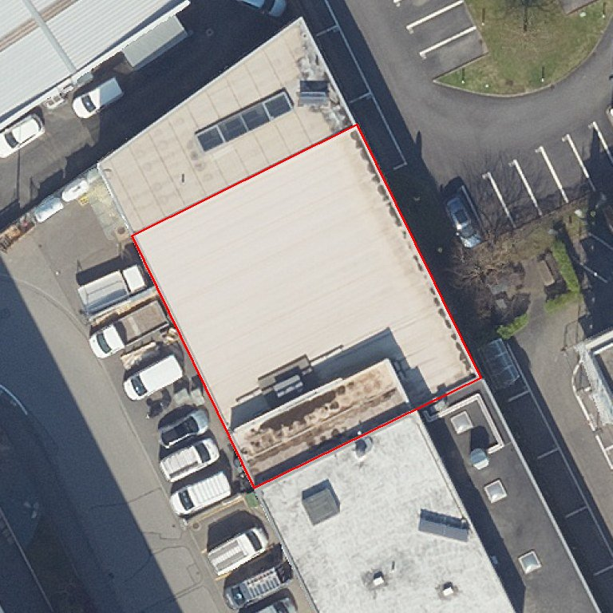
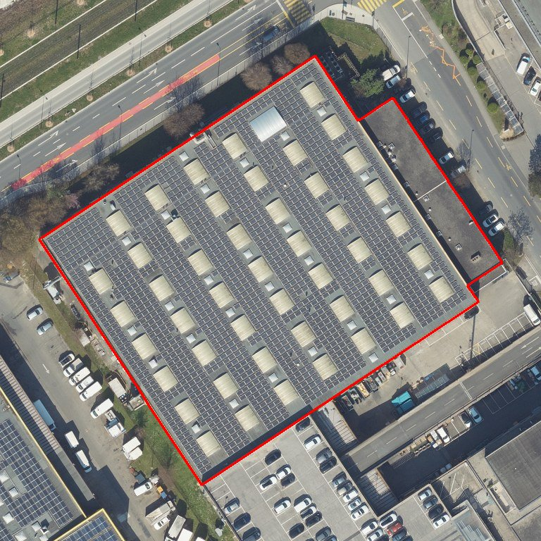
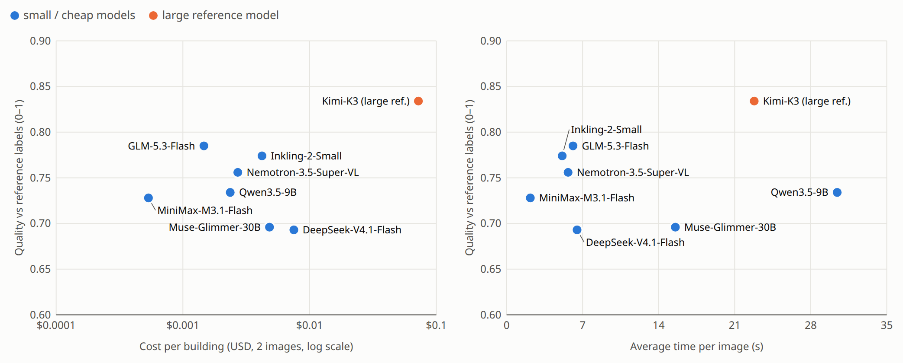
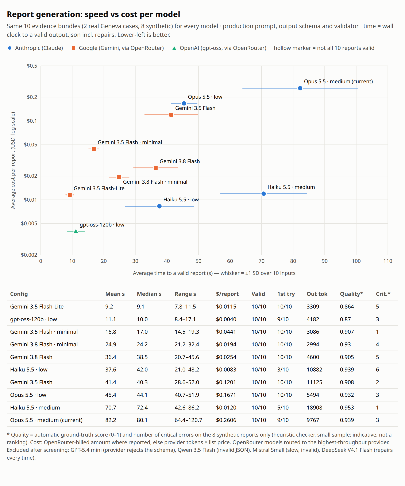

<p align="center">
  

</p>

<h1 align="center">AXAlotl</h1>

<p align="center"><b>AI-powered property risk assessment that automates underwriting reports for Swiss insurers.</b></p>

<p align="center">
  <a href="https://lauz-hack-webapp.vercel.app">Web app</a> ·
  <a href="https://lauz-hack-webapp.vercel.app/dashboard.html">Dashboard</a>
  <br><sub>LauzHack 2026 · AXA challenge: <i>frugal use of multimodal AI</i></sub>
</p>

---

## The problem and our solution

Small and medium-sized enterprises (SMEs) want to insure the commercial buildings they operate from: workshops, production sites, warehouses. To quote a **premium** and decide on the cover, the insurer has to assess the **risk** of that specific building. That means a long list of risk factors, from the building's [construction and condition (COPE: *Construction, Occupancy, Protection, Exposure*](investopedia.com/terms/c/cope-insurance.asp?__cf_chl_tk=hz4_DUNBE1L9czYsP2opy3UrNBAQvfsNnPwq0RrBvwk-1795336125-1.0.1.1-3yPp6znRdMNlM6g3x5Fhwkj2rj0KFghG06jJ377IU4I) to the industrial activity inside it and its exposure to natural hazards.

Today an [underwriter collects these factors by hand from registers, maps, aerial imagery and the company's website](https://www.investopedia.com/terms/i/insurance-underwriter.asp). It takes hours per building and is costly.

**AXAlotl automates most of this research.** From three inputs (client name, company name, building address), it:

1. [collects the risk factors from official Swiss and Geneva sources](#data-extraction)
2. [reads the images (aerial photo, facade, website photos) with a small vision model](#what-the-vision-model-does-and-why)
3. [writes a standardized underwriting report.](#report-generation) Every statement in the report is linked to its evidence, and the report says clearly what is **verified**, what is **inferred** and what is still **unknown** (those become questions for the client).

A job that took an underwriter hours now runs **in under a minute for a few cents**. Measured on 50 real Geneva companies, end to end on two examples: **34 s / $0.015** and **47 s / $0.033**.

---

## Data extraction

The ETL (`src/pipeline.py`) turns the client request into **19 risk features**. Each one carries its value, a **status** and the IDs of the sources it comes from:

| Status | Meaning |
|---|---|
| `verified` | read from an official register or geodata layer |
| `observed` | seen by the vision model on an image (to be confirmed) |
| `inferred` | deduced from the company website, the business sector or the declared industry |
| `declared` | stated by the client |
| `estimated` | computed by us from other data (e.g. a value from a volume) |
| `unknown` | not found in any source. Never guessed: `value = null` |

We distinguish **extracted** features, read from a source as they are, from **generated** features, which we compute or infer ourselves. A status is never upgraded: an inference never becomes "verified".

### Building (construction and condition)

| Feature | Type | How we get it |
|---|---|---|
| `building_usage` | extracted | Geneva cadastre (SITG), building destination |
| `construction_year` | extracted | Federal building register (RegBL), cross-checked with the cadastre's construction period |
| `number_of_floors` | extracted | RegBL / SITG cadastre |
| `floor_area_m2` | extracted, else **generated** | heated area from the SITG energy index; fallback: footprint × floors |
| `roof_type_material` | extracted + **vision** | shape from the 3D cadastre (roof slope); material from the aerial photo |
| `construction_material` | **vision** | Street View facade photo, with safeguards (facade visible, matching sign or floor count) |
| `building_renovations` | extracted | building permits + transformation year from the cadastre |
| `potential_repair_needs` | **vision** | aerial photo: possible damage, always flagged "to inspect", never "confirmed" |
| `reconstruction_value_chf` | **generated** | building volume (cadastre) × CHF/m³ by building type, indexed on the Geneva construction cost index. Given as a range, explicitly approximate |

### Occupancy and industrial fire risk

| Feature | Type | How we get it |
|---|---|---|
| `business_sector` | extracted | cantonal business register (NOGA code), compared with the industry declared by the client |
| `site_industrial_processes` | extracted + **inferred** | building permits, polluted-sites cadastre, company website (vision/text model), typical processes of the industry |
| `high_temperature_operations` | extracted + **inferred** | permits (furnaces, kilns…), website, industry |
| `gas_installations` | extracted + **inferred** | **Geneva boiler register**, permits mentioning gas, industry |
| `flammable_material_storage` | extracted + **vision** | oil boiler / tank in the registers, permits, polluted sites, outdoor storage seen on the aerial photo |

Fire protection (sprinklers, fire alarm, compartmentation, inspections), loss history and pipe condition are **not available in public data**. They are added as `unknown`, and the report turns them into questions for the client. A missing record is never read as "absent".

### External factors (natural hazards)

| Feature | Type | How we get it |
|---|---|---|
| `earthquake_exposure` | extracted | SIA 261 seismic zone + soil class (FOEN) |
| `flood_exposure` | extracted | cantonal flood hazard maps (SITG) |
| `surface_runoff_exposure` | extracted | FOEN surface runoff map: share of the building's perimeter exposed, and **water depth read from the map's colour legend** (pixel analysis, no AI) |
| `hail_exposure` | extracted | MeteoSwiss 50-year hail size |
| `landslide_exposure` | extracted | cantonal landslide hazard maps |

The pipeline also identifies the company and the building: Zefix UID, register status and bankruptcy signals, EGID (unique building ID), and whether other companies share the building.

### What the vision model does, and why

Some risk factors exist only in images, so we use a **small, cheap vision-language model** (`google/gemini-2.5-flash-lite`) for exactly three calls per building:

| Call | Image | What it returns (strict JSON schema) |
|---|---|---|
| **Aerial** | SWISSIMAGE orthophoto, cropped to the building, insured footprint drawn in red from the official cadastre (matched by EGID) | roof type and material, solar panels, skylights, roof equipment, outdoor storage, vegetation and neighbours close to the walls, possible roof issues |
| **Facade** | Google Street View photo (demo source) | is the facade actually visible? wall material, visible floors, condition, storage along the walls, does a sign match the company? |
| **Website** | company website text + up to 3 photos | activity summary, processes, gas, high-temperature operations, flammable materials, protections mentioned. Each claim is flagged as building-specific or company-wide |

**Why it is built this way (token efficiency):**
- **Specialized and cheap.** A small vision model answers narrow questions into a strict JSON schema with short fields. It is not asked to write the report.
- **Images are read once.** Only the structured observations travel downstream. The report model **never receives pixels**: one image costs thousands of tokens; its observations cost a few dozen.
- **Low output.** Capped outputs (`max_tokens` 700–1,400) and a "never invent, unknown stays unknown" system prompt.
- **Cached per image,** so re-running a building costs nothing.

**Measured cost: about 2,600–2,800 input and 900–1,000 output tokens for all three calls, ≈ $0.0006–0.0007 per building** (`etl` in `metrics.json` of the [example reports](examples/reports/)).

### Vision model benchmark

Which small vision model should do this job? We compared 9 serverless vision models on the two image tasks of the pipeline, aerial photo and street facade. All used the same production prompt and JSON schema (`src/prompts.py`).

**Example 1: CMDS SA, Plan-les-Ouates**

<table><tr>
<td width="42%"></td>
<td>

| Feature | GLM-5.3-Flash output |
|---|---|
| Roof | flat_or_low_pitch — light membrane or metal sheet, seams visible |
| Solar panels | Unknown |
| Skylights | Unknown |
| Roof equipment | dark units near southern roof edge |
| Outdoor storage | Unknown |
| Neighbours < 10 m | Present |
| Vegetation at walls | Unknown |
| To inspect | brown patches on lower south roof section, inspect for debris or corrosion |

4.8 s · $0.0006

</td>
</tr></table>

**Example 2: Jean Gallay SA, Plan-les-Ouates**

<table><tr>
<td width="42%"></td>
<td>

| Feature | GLM-5.3-Flash output |
|---|---|
| Roof | flat roof — Unknown |
| Solar panels | Present |
| Skylights | Present |
| Roof equipment | white rectangular rooftop structure near north edge, purpose unknown |
| Outdoor storage | Unknown |
| Neighbours < 10 m | Present |
| Vegetation at walls | Possible |
| To inspect | none reported |

3.1 s · $0.0004

</td>
</tr></table>

Unknown stays unknown (CMDS: the model does not guess solar panels or storage it cannot see), and possible damage is flagged "to inspect", never as confirmed. The examples are aerial photos only: Street View images cannot be published in a public repository (Google's terms).

**Quality vs cost and speed** (upper-left is better):

<p align="center"></p>

**How we measured quality**
- **Data:** 8 real images from the pipeline (4 Geneva buildings × aerial + facade), each sent twice to every model: 144 calls, $0.77.
- **Reference:** we labelled by eye only what is clearly visible (`benchmark/vlm/labels.json`): roof type, solar panels, skylights, close neighbours, roof equipment, facade material, outdoor storage, company sign.
- **Score:** 1 point per correct feature, 0.5 for a cautious answer ("possible" / "unknown" / a close material), 0 if wrong or invalid JSON. Quality = average (0–1).
- **Cost / time:** Together tokens × list price (reasoning included) · wall clock per image.
- **Caveat:** 4 buildings is a small sample: read it as a ranking, not a precise measure.

**Result:**
- **GLM-5.3-Flash** gives the best quality of the small models: 0.79, close to the large Kimi-K3 at 0.83. It costs **$0.0015 per building** (≈ 50× cheaper than Kimi-K3) at 6 s per image.
- **MiniMax-M3.1-Flash** is the fastest and cheapest valid option, at 2.2 s and $0.0005 per building, with quality 0.73.

Reproduce: `python -m benchmark.vlm.run`, then `python -m benchmark.vlm.report --readme`.

---


## Report generation

`python -m src.report` (`src/report/`) turns the features into a validated underwriting report:

1. **Evidence bundle, deterministic and with no LLM** (`src/report/evidence.py`). The features become an evidence register with stable IDs: `feat.<feature>` for facts, `src_N` for sources, `vis.*` for images. Missing protections are added as unknown facts, and contradictions between sources are flagged (e.g. register year vs cadastre period).
2. **One LLM call with a strict output schema** (`schemas/OUTPUT/report_output.v1.schema.json`). The model writes the narrative only: executive summary, COPE assessment, up to 6 priority findings, hazard interpretation, valuation comment, up to 8 questions for the client, and the next step for the underwriter. **Every statement cites evidence IDs.** It never writes numbers, sources or images itself; the dashboard resolves those from the evidence register.
3. **Validation** (`src/report/validate_report.py`):
   - the report matches the schema;
   - every cited ID exists;
   - no premium is quoted;
   - no individual pricing of regulated natural hazards;
   - an unknown protection is never asserted (e.g. "sprinklers installed");
   - amounts not found in the evidence are flagged;
   - every unknown feature becomes a question.

   An invalid report gets **one bounded repair**; if it is still invalid, it is never presented as a report.
4. **Metrics for every report:** tokens (input, output, reasoning, cache), billed or estimated USD, latency, retries and stage status (`metrics.json`).

**How we keep token usage low:**
- no images sent to the report model;
- one generation call instead of a chain of calls;
- values are referenced by ID instead of rewritten;
- short, capped text fields defined in the schema;
- the model choice is driven by measured cost and latency.

### Model benchmark

Same 10 evidence bundles (2 real Geneva cases, 8 synthetic) for every model, with the production prompt, schema and validator. Time = wall clock until a valid `output.json`, repairs included.

<p align="center"></p>

An independent LLM judge (GPT-6.1 Terra, 15 synthetic validation cases, 1–5 scale) rated factual grounding highest for Opus (3.9) and lowest for Gemini 3.5 Flash (2.2). The default (Flash-Lite) favours speed and cost; the report prompt was later tuned for it. The model is one setting (`REPORT_MODEL`, configs in `models/configs.json`).

### Example output

Two real reports, generated end to end with the default model:

- [`examples/reports/cmds-sa/`](examples/reports/cmds-sa/): CMDS SA, metalworking, Plan-les-Ouates
- [`examples/reports/jean-gallay-sa/`](examples/reports/jean-gallay-sa/): Jean Gallay SA, Plan-les-Ouates

Each folder contains `output.json` (the report), `features_combined.json` (evidence register), `metrics.json` (tokens, cost, time) and `etl_output.json` (raw extraction). Only the swisstopo orthophoto is committed: Street View and website photos are not stored, because of their terms of use. How a frontend displays these files is described in [`docs/FRONTEND_INTEGRATION.md`](docs/FRONTEND_INTEGRATION.md).

---

## Limitations

- **Geneva only.** We focus on the canton of Geneva for two reasons:
  - it publishes unusually rich open geodata (SITG: cadastre, 3D roofs, boiler register, building permits, polluted sites, hazard maps);
  - it is one of the few cantons **without a cantonal monopoly building insurer**. Buildings there are insured on the **private market**, where insurers such as AXA compete. In most other cantons, fire and natural-hazard cover for buildings is provided by a public cantonal insurer.

  The natural-hazard part of building insurance follows a **regulated, uniform tariff** in the private-market cantons, so the pipeline uses hazard exposure for underwriting and prevention, never for an individual surcharge.
- **Our own feature set.** We do not know the insurers' internal pricing models. We derived the 19 risk features ourselves from what underwriters typically assess and from what public data can provide. The reconstruction value is an indicative range, not an appraisal.
- **Public data only.** Fire protection, loss history and the true insured value are not public: they always end up as questions for the client.
- **Demo sources.** Street View is used for the demo under restrictive terms. Production would need licensed imagery or photos supplied by the client.
- **Evaluation.** Report quality was measured on synthetic cases and a handful of real ones, with automatic checks and an LLM judge. No underwriter has rated the reports yet.

---

## What's next

**Feature extraction**
- **Align on the insurer's real rating factors.** Knowing exactly which features an insurer's risk model uses would let us build a clear framework for data gathering: which features, from which source, with which precision.
- **Fallback data sources.** When a primary source is down or has no record, switch automatically to a secondary one, and record which one was used.

**Report generation**
- **Learn the underwriting team's preferences.** Fine-tune the report model with reinforcement learning from preferences (e.g. GRPO) so it writes the way the team wants. This needs quality preference data: underwriters choosing between report versions and flagging errors. The dashboard, where underwriters already review every report, is the natural place to collect it.
- **Continuous improvement.** Use the feedback of the team working with the reports to keep improving the model over time.

---

## Run it

```bash
python -m venv .venv && .venv/bin/pip install -r requirements.txt uvicorn
cp .env.example .env                      # set LLM_API_KEY (OpenRouter), GOOGLE_MAPS_API_KEY
.venv/bin/python -m src.report --input schemas/INPUT/example.customer_request.json --output reports/cmds-sa
.venv/bin/python -m src.report --metrics reports/cmds-sa     # tokens, cost, time
```

- **API:** `uvicorn src.main:app --reload` → `POST /api/reports/stream` (live report with streamed progress), `GET /api/cases` (stored reports).
- **Web app and dashboard:** `cd webapp && npm install && npx vite` (see [`docs/WEBAPP.md`](docs/WEBAPP.md)).
- **Deployment:** two Vercel projects deploy on every push to `main`: the backend (`lauz-hack`) and the web app (`lauz-hack-webapp`, root `webapp/`). Online reports are stored in a private Vercel Blob store. See [`docs/DEPLOY_VERCEL.md`](docs/DEPLOY_VERCEL.md).
- **Data contracts:** [`schemas/README.md`](schemas/README.md) (INPUT → FEATURE → COMBINED_FEATURE → OUTPUT).

**Sources:** [Zefix](https://www.zefix.ch) · [RegBL](https://www.housing-stat.ch) · [SITG](https://sitg.ge.ch) · [geodienste.ch](https://geodienste.ch) · [geo.admin.ch](https://www.geo.admin.ch) · [SWISSIMAGE](https://www.swisstopo.admin.ch/fr/orthophotos-swissimage-10-cm) · [MeteoSwiss](https://www.meteoswiss.admin.ch) · [OpenRouter](https://openrouter.ai)
