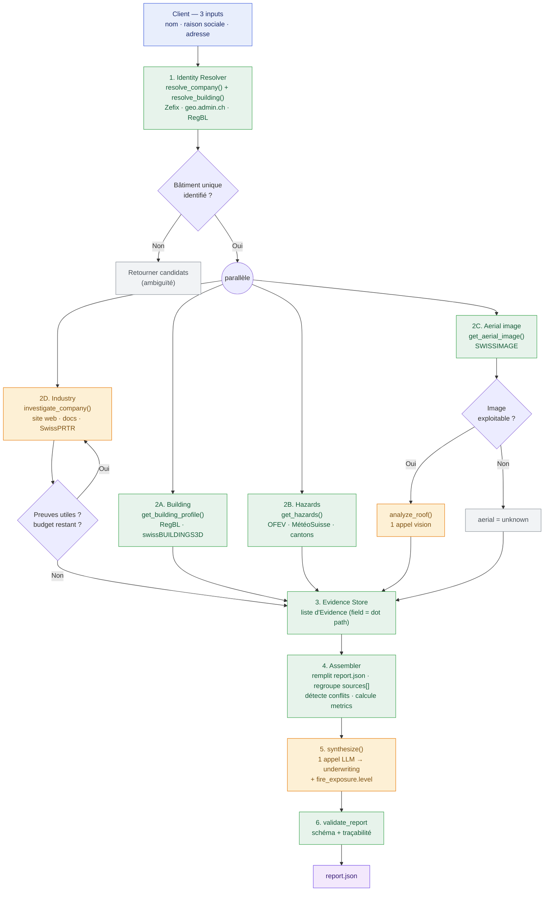

# AXA Smart Property — Plan de réalisation

Hackathon AXA B2B · LauzHack 2026

**But :** à partir de **3 champs client** (nom, raison sociale, adresse), produire automatiquement un **dossier de pré-souscription** pour un bâtiment : identité, caractéristiques, valorisation, dangers naturels, exposition incendie, protections, entretien, inconnues à vérifier. Chaque valeur est sourcée.

**Principe :** *API first, LLM last.* Tout ce qui se fait en Python (géocodage, registres, SIG, rasters, assemblage) coûte 0 token. Le LLM n'intervient que pour la vision, l'extraction industrielle et la synthèse finale.

**Livrable :** un **`report.json`** conforme à [`schemas/report.schema.json`](schemas/report.schema.json) (v1.0). Le rapport lisible (UI/PDF) sera généré plus tard **à partir du JSON par templates**, sans appel LLM supplémentaire. On ne calcule **ni prime ni score actuariel**.

```
schemas/report.schema.json    # contrat agent ↔ backend ↔ frontend
schemas/report.example.json   # exemple complet et valide (fictif)
prompts/system.md             # règles LLM + I/O des 3 appels
src/main.py                   # API FastAPI (déployée sur Vercel)
src/llm.py                    # TOUS les appels LLM passent par ici : routing, json_schema, cache, tokens, coût
src/cache.py                  # cache Upstash Redis (prod) / fichiers (local)
src/config.py                 # variables d'env, modèles, prix CHF hardcodés
src/validate_report.py        # validation schéma + traçabilité des sources
.env.example                  # variables à définir
```

```bash
python -m venv .venv && .venv/Scripts/pip install -r requirements.txt uvicorn
cp .env.example .env                                         # remplir la clé + les modèles
python -m src.validate_report schemas/report.example.json    # → OK
uvicorn src.main:app --reload                                # GET /api/health · POST /api/report
```

`MOCK_MODE=1` (défaut) : `POST /api/report` renvoie l'exemple validé avec la requête injectée → le front peut avancer sans pipeline et sans tokens.

---

## 1. Pipeline



🟩 Python, 0 token · 🟧 appel LLM · ⬜ sortie dégradée / arrêt

**Le LLM ne réécrit jamais le rapport entier.** Chaque appel renvoie uniquement son sous-objet du schéma (structured output imposé par schéma) ; Python assemble le reste.

---

## 2. Les tools — qui remplit quoi

| Tool | Input | Remplit dans `report.json` | Sources | LLM |
|---|---|---|---|---|
| `resolve_company()` | raison sociale | `company.{registered_name, uid, legal_form, registered_seat}` | Zefix Linked Data (SPARQL) | 0 |
| `resolve_building()` | adresse | `building.{resolved_address, coordinates, canton, commune, egid}` | geo.admin.ch SearchServer + RegBL | 0 |
| `get_building_profile()` | EGID | `building.{category, construction_year, age_years, floor_count, footprint_m2, floor_area_m2, height_m, roof_shape, terrain_altitude_m, cantonal_insurance_regime}` | RegBL, swissBUILDINGS3D, API Height, règle cantonale | 0 |
| `get_hazards()` | géométrie + canton | `external_hazards.*` (11 dangers) | OFEV, MétéoSuisse, geodienste.ch | 0 |
| `get_aerial_image()` | géométrie | `aerial.{image_url, image_date, attribution, neighbour_min_distance_m}` | SWISSIMAGE, géométrie voisins | 0 |
| `analyze_roof()` | image recadrée | `aerial.{pv_panels, roof_equipment, vegetation_nearby, observations}`, `maintenance.potential_issues` | modèle vision | 1 appel |
| `investigate_company()` | entreprise + adresse | `company.{business_sector, noga_code, site_activities, occupies_building}`, `fire_exposure.*` (sauf level), `protection_systems` | site officiel, PDF publics, SwissPRTR | plafonné |
| `estimate_reconstruction()` | `floor_area_m2` | `valuations.estimated_reconstruction_cost` | surface × coût de référence (formule) | 0 |
| `synthesize()` | rapport assemblé compact | `underwriting`, `fire_exposure.{preliminary_level, explanation}` | — | 1 appel |

Prompts et I/O exacts des 3 appels LLM : [`prompts/system.md`](prompts/system.md).

### Endpoints & couches

```
# Géocodage adresse
GET https://api3.geo.admin.ch/rest/services/ech/SearchServer?searchText=<adresse>&type=locations

# Registre des bâtiments (EGID → gkat, gbauj, gastw…)
layer: ch.bfs.gebaeude_wohnungs_register      # via Find Features / Identify API

# Zefix
SPARQL: https://ld.admin.ch/sparql/
```

| `external_hazards.*` | Couche / source | MVP |
|---|---|---|
| `surface_runoff` | `ch.bafu.gefaehrdungskarte-oberflaechenabfluss` — intersection emprise | ✅ |
| `earthquake` | `ch.bafu.gefahren-gefaehrdungszonen` (zone SIA 261) + `ch.bafu.gefahren-baugrundklassen` (sol) | ✅ |
| `hail` | `ch.meteoschweiz.hagelgefaehrdung-korngroesse_50_jahre` (et `_10_jahre`) — raster COG via STAC, ~1 km, en cm | ✅ |
| `river_flood`, `landslide`, `rockfall`, `avalanche` | geodienste.ch / géoportails cantonaux — seulement si le canton est accessible | extension |
| `windstorm`, `heavy_snow`, `lightning`, `wildfire` | pas de source fiable directe → `not_assessed` par défaut | extension |

Chaque danger a la même structure : `level`, `assessment_basis`, `observation`, `measurement_value`, `measurement_unit`. Non traité ⇒ `level: "unknown"`, `assessment_basis: "not_assessed"`.

Champs RegBL utiles : `gkat` (catégorie), `gbauj` (année de construction), `gastw` (nb de niveaux).

### Pièges à connaître

- **Ruissellement ≠ crue.** Deux dangers séparés.
- Certaines couches geo.admin.ch sont du **WMTS d'affichage** : lire le jeu vectoriel/raster sous-jacent, jamais déduire un niveau depuis une couleur.
- **Zefix ne prouve pas** que l'entreprise occupe le bâtiment → `company.occupies_building`.
- **Emprise au sol ≠ surface de plancher.** `footprint_m2` ≠ `floor_area_m2`.
- Une orthophoto **ne permet pas** de conclure sur sprinklers, gaz ou résistance au feu.
- Une info trouvée au niveau de l'entreprise reste `possible` + `building_specific: false` tant qu'aucune preuve ne la rattache **à ce site**.
- geo.admin.ch : gratuit mais **fair use** → cache obligatoire.

---

## 3. Evidence (sortie interne de chaque tool)

Chaque tool retourne une liste d'`Evidence`. `field` est **directement le dot path** du rapport, donc l'assembleur n'a qu'à copier la valeur et regrouper les sources.

```json
{
  "field": "fire_exposure.high_temperature_processes",
  "value": "confirmed_present",
  "source": {
    "provider": "Site officiel de l'entreprise",
    "kind": "company_website",
    "url": "https://example.com/production",
    "retrieved_at": "2026-11-21"
  },
  "reliability": "inferred",
  "building_specific": false,
  "excerpt": "We offer thermal treatment of steel parts."
}
```

L'assembleur fusionne les Evidence de même source en une entrée de `sources[]` avec `supports_fields` (une URL n'est écrite qu'une fois → moins de tokens). Si deux Evidence donnent des valeurs différentes pour un même `field`, il les garde **toutes les deux** dans `underwriting.conflicts` — jamais de choix silencieux.

---

## 4. Format final — `report.json` (v1.0)

Schéma complet : [`schemas/report.schema.json`](schemas/report.schema.json) · exemple valide : [`schemas/report.example.json`](schemas/report.example.json)

| Bloc | Contenu |
|---|---|
| `request` | les 3 inputs client |
| `company` | nom Zefix, UID, forme juridique, siège, secteur, code NOGA, activités **du site**, CA annuel, `occupies_building` |
| `building` | EGID, adresse résolue, coordonnées LV95/WGS84, canton, commune, catégorie, année, âge, étages, emprise, surface de plancher, hauteur, toit, altitude, régime d'assurance cantonal |
| `aerial` | image (url, date, attribution), PV, équipements toit, végétation, distance au voisin, observations |
| `valuations` | `estimated_market_value` et `estimated_reconstruction_cost` séparés : best/low/high CHF + `status` + méthode |
| `external_hazards` | 11 dangers, structure identique |
| `fire_exposure` | niveau préliminaire, gaz, haute température, inflammables, chimiques, procédés, voisins dangereux |
| `protection_systems[]` | sprinklers, détection, compartimentage, paratonnerre, protection crue… + `presence` |
| `maintenance` | périmètre de l'évaluation, problèmes potentiels → **recommandations d'inspection**, pas de dégâts confirmés |
| `underwriting` | constats, facteurs aggravants, infos manquantes, conflits, recommandations |
| `sources[]` | centralisées : provider, kind, url, date, `reliability`, `building_specific`, extrait, `supports_fields` |
| `metrics` | champs remplis / applicables, appels outils (durée, tokens, cache), tokens totaux, coût, durée |

### Conventions

| Donnée | Type | Exemple |
|---|---|---|
| Montant, surface | `number \| null` | `2500000.0`, `1850.5` |
| Année, étages | `integer \| null` | `1998` |
| Texte | `string \| null` | `"Toit plat"` |
| Niveau de risque | enum | `low` · `moderate` · `high` · `very_high` · `unknown` |
| Présence d'équipement | enum | `confirmed_present` · `confirmed_absent` · `possible` · `unknown` |
| Fiabilité d'une source | enum | `verified` (officiel/preuve directe) · `observed` (vision) · `inferred` (indirect) |
| Statut d'une valorisation | enum | `not_estimated` · `derived_calculation` · `model_estimate` · `documented` |

Règles clés :
- **Tous les champs sont obligatoires**, `null` / `"unknown"` quand on ne sait pas. **Inconnu ≠ zéro ≠ absent.** Absence de preuve ⇒ `unknown`, jamais `confirmed_absent`.
- **Valeur de reconstruction ≠ valeur vénale.** Pour l'assurance bâtiment (valeur à neuf), c'est la reconstruction qui compte ; la valeur vénale inclut le terrain. MVP : `not_estimated` tant qu'on n'a pas `floor_area_m2` + un coût de référence validé. **Jamais estimé par le LLM.**
- **CA annuel** décrit l'entreprise, pas le bâtiment ; souvent `null` pour les SA/Sàrl privées.
- Chaque valeur factuelle (hors `request`, `underwriting`, `metrics`) doit être citée dans un `sources[].supports_fields`. Les URL doivent venir des résultats de tools, jamais du LLM.

### Validation (backend)

`src/validate_report.py` vérifie : conformité au schéma, ids de sources uniques, `supports_fields` pointant vers des champs existants, ids cités dans `conflicts` existants, et que **toute valeur connue est couverte par une source**. Un rapport qui échoue est rejeté. Le schéma garantit la structure, pas la véracité : d'où le contrôle de traçabilité.

---

## 5. Budget tokens

| Étape | Budget cible |
|---|---|
| Géocodage, RegBL, SIG, rasters, assemblage | 0 |
| Recherche web (HTTP) | 0 token LLM |
| Extraction industrielle | ~2 000 input |
| Vision | 1 image + ~300 output |
| Synthèse finale | ~2 000 input + ~700 output |
| Rendu rapport lisible | 0 (templates) |

Règles :
1. **Recherche web en 2 temps** : d'abord titres/URL/extraits, puis ouvrir **max 3–5 sources** (site officiel en priorité).
2. **Extraction ciblée** : dans un long PDF, ne passer que les pages procédés/équipements.
3. **Une seule image**, recadrée sur l'emprise du bâtiment (sinon coût ↑ et risque de décrire le voisin).
4. **Sous-schémas** : chaque appel LLM ne produit que ses champs, pas le rapport entier.
5. **Cache** par EGID / couche / URL avec date de récupération. Le nom du client **jamais** dans la clé de cache.
6. **Stop condition** : chaque recherche répond à une question précise ; on s'arrête dès preuve suffisante ou budget atteint.

---

## 6. Stack, modèles & hébergement

**Rien ne tourne en local côté modèles.** Pas de GPU, pas d'endpoint dédié : on appelle des **API serverless au token**, toutes compatibles OpenAI → un seul client (`src/llm.py`), on change de fournisseur avec `LLM_BASE_URL`.

| Rôle | Fournisseur |
|---|---|
| Principal | **OpenRouter** — clé AXA ($10). Jury = fournisseur de la clé : tenir dans ce budget est un argument. |
| Secours | **Together** ou **Nebius Token Factory** (API au token, pas les endpoints GPU Nebius) |
| À éviter | GPU / endpoints dédiés : facturés à l'heure même idle, setup long |

**Cascade de modèles** (`MODEL_VISION`, `MODEL_EXTRACTION`, `MODEL_SYNTHESIS`) : petit VLM pour les images, petit modèle texte pour l'extraction, modèle plus capable **uniquement** pour la synthèse. Vérifier chez le fournisseur que chaque modèle accepte les images (vision) et `response_format: json_schema`. Tester 2–3 candidats par rôle sur les bâtiments du benchmark, garder le moins cher qui passe le validateur.

**Règles `src/llm.py`** (ne jamais appeler le SDK directement ailleurs) :
- sortie `json_schema` stricte + validation `jsonschema` + **1 retry** max avec l'erreur ;
- **cache** par hash (modèle + messages + schéma + images) → un appel identique n'est jamais repayé (dev compris : protège les $10) ;
- chaque appel renvoie sa métrique (durée, tokens, cache_hit, coût) → `build_metrics()` remplit `metrics` ;
- coût en CHF via `MODEL_PRICES_CHF_PER_MTOK` dans `src/config.py` (prix hardcodés, approximatifs — à remplir).

### Déploiement Vercel (cible finale)

Le backend est une **app FastAPI = une seule fonction Python** sur Vercel (détection zero-config, Python 3.13 via `.python-version`). Contraintes à respecter **dès maintenant** :

| Contrainte Vercel | Conséquence pour nous |
|---|---|
| Filesystem en lecture seule, `/tmp` éphémère | **Pas de cache/DB sur disque en prod** → Upstash Redis (Vercel Marketplace, REST) ; `src/cache.py` bascule tout seul si `UPSTASH_*`/`KV_*` est défini. Pas de SQLite. |
| Aucune mémoire entre requêtes | Pas d'état global ; tout passe par le cache ou le `report.json` |
| Durée max 300 s (Hobby) | Pipeline cible **< 60 s** ; branches en parallèle ; recherche web plafonnée |
| Bundle Python 500 Mo | **Pas de GeoPandas.** Préférer les API geo.admin.ch (Identify/Find renvoient les attributs côté serveur) ; `shapely` pour la géométrie ; `rasterio` seulement si nécessaire (lecture COG à distance par range requests, pas de téléchargement de rasters entiers) |
| Body requête/réponse ≤ 4.5 Mo | Les images sont **récupérées côté serveur**, jamais uploadées par le client ; le rapport renvoie des URL, pas d'images en base64 |
| Variables d'env | Dans Vercel → Settings → Environment Variables (`vercel env add`), jamais commitées |

Plus tard, quand le site arrive : Next.js et FastAPI dans **le même projet Vercel** via `services` dans `vercel.json` (`/api/*` → backend, le reste → front), et progression de la pipeline en streaming (SSE) vers l'UI.

---

## 7. Roadmap

| # | Phase | Blocs remplis |
|---|---|---|
| 1 | Data foundation — géocodage, EGID, RegBL, Zefix, règle cantonale | `request`, `company` (registre), `building` |
| 2 | Natural hazards — OFEV, MétéoSuisse | `external_hazards` (ruissellement, séisme, grêle) |
| 3 | Multimodal — orthophoto, recadrage, vision | `aerial`, `maintenance` |
| 4 | Industrial — recherche web ciblée, extraction de preuves | `company` (activité), `fire_exposure`, `protection_systems` |
| 5 | Assembler — Evidence → report, `sources[]`, conflits | `sources`, `underwriting.conflicts` |
| 6 | Synthèse + validation | `underwriting`, rapport validé |
| 7 | Benchmark — tokens, coût, temps, qualité | `metrics` |

**MVP obligatoire (bout en bout) :** 3 champs → EGID → RegBL → ruissellement/séisme/grêle → 1 image analysée → 1 recherche industrielle sourcée → `report.json` qui passe `validate_report`.

**Extensions :** cartes cantonales (crues, glissements, chutes de pierres, avalanches), estimation de reconstruction, investigation des protections, rendu UI/PDF.

### Bonus — Vision sur les photos du site de l'entreprise

L'orthophoto montre le toit, pas le risque incendie. Les pages *production*, *Über uns* et les brochures montrent souvent l'intérieur : **fours, citernes de gaz, stockage de palettes/solvants, sprinklers au plafond**. C'est là que l'image apporte le plus à AXA, et c'est exactement ce que les registres ne donnent pas.

Tool `analyze_site_photos()`, branché après `investigate_company()` :

1. **Sélection sans LLM** des images déjà récupérées par la recherche web : `alt`, nom de fichier, mots-clés de la page (`production`, `Fertigung`, `atelier`, `Halle`…), taille minimale (ignorer logos/icônes), dédoublonnage. **Max 2–3 images.**
2. **Petit VLM bon marché**, image redimensionnée (~512–768 px), sortie en sous-schéma : présence de fours / citernes / stockage inflammable / sprinklers / détection.
3. Résultat → `fire_exposure.*` et `protection_systems[]` avec une source `kind: "company_photo"`, `reliability: "observed"`, `building_specific: false` tant que rien ne rattache la photo à **cette adresse**.

Budget : 2–3 images + ~200 tokens output. Stop si aucune image ne passe le filtre (0 appel).

---

## 8. Évaluation (pour les juges)

Tester sur **3 bâtiments réels** : bureaux, entrepôt, industrie. Comparer avec un agent généraliste non optimisé (longs documents en contexte, rapport entier généré par le LLM).

| Métrique | Mesure |
|---|---|
| Couverture | `metrics.fields_filled / fields_applicable` |
| Exactitude | vérif manuelle contre les sources |
| Précision industrielle | % d'affirmations étayées par une preuve correcte |
| Inconnues critiques détectées | `underwriting.missing_information` vs checklist définie à l'avance |
| Tokens / coût / temps par rapport | `metrics` |

L'optimisation ne compte que si le coût baisse **sans perte de qualité ni de couverture**.

---

## Liens

- geo.admin.ch : [Search API](https://docs.geo.admin.ch/access-data/search.html) · [Find Features](https://docs.geo.admin.ch/access-data/find-features.html)
- [RegBL — données publiques](https://www.gwr.admin.ch/fr/data/supply/public_content.html)
- [Zefix Open Data](https://opendata.swiss/fr/dataset/zefix-zentraler-firmenindex) · [SPARQL](https://ld.admin.ch/sparql/)
- [OFEV — Ruissellement](https://www.bafu.admin.ch/fr/ruissellement) · [Cartes de dangers cantonales](https://www.geodienste.ch/services/gefahrenkarten?locale=fr)
- [MétéoSuisse — Grêle](https://opendatadocs.meteoswiss.ch/c-climate-data/c5-radar-based-climate-data)
- [SWISSIMAGE](https://www.swisstopo.admin.ch/fr/orthophotos-swissimage-10-cm) · [swissBUILDINGS3D](https://www.swisstopo.admin.ch/fr/modele-du-territoire-swissbuildings3d-3-0-beta)
- [SwissPRTR](https://www.bafu.admin.ch/fr/swissprtr-fr)
- [AXA — Assurance des bâtiments commerciaux](https://www.axa.ch/fr/clients-entreprises/offres/inventaire-immobilier/assurance-batiments.html)
